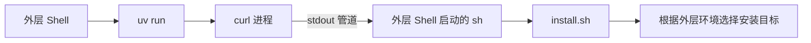

# M01 · Ch00 · L01｜安装与首次运行

> 学习日期：2026-08-24<br>
> [返回 Ch00](README.md) · 下一节：[L02 安装脚本、TTY 与 WebUI 构建](02-安装脚本TTY与WebUI构建.md)

## 本次只解决一个问题

建立 NanoBot 的首次可运行基线，并识别“源码项目环境、安装脚本环境、当前 Shell 环境”
可能不是同一个环境。

## 已执行操作

```bash
cd nanobot
uv sync

uv run curl -fsSL https://raw.githubusercontent.com/HKUDS/nanobot/main/scripts/install.sh | sh

which nanobot
```

`which nanobot` 输出：

```text
<python-cookbook>/.venv/bin/nanobot
```

之后成功启动服务、配置本地模型并发起问答，获得了带引用的回答。

## 已确认的事实

- NanoBot 源码依赖已经执行过 `uv sync`。
- 当前 Shell 执行 `which nanobot` 时，首先匹配到 `python-cookbook/.venv/bin/nanobot`。
- 至少有一个 NanoBot Runtime 能够正常启动。
- 本地模型配置有效，能够完成一次真实问答。
- 用户界面展示了回答引用。
- 官方提供与 `0.3.0` 对应的[中文使用文档](https://nanobot.wiki/cn/docs/0.3.0/getting-started/nanobot-overview)。

## 推断，但尚未确认

- 当前 Shell 可能仍激活或保留着 `python-cookbook/.venv/bin` 的 PATH 优先级。
- 安装脚本可能识别到了外层 Shell 的活动虚拟环境，但 `which` 的结果不足以单独证明这一点。
- 已启动的服务可能来自 `python-cookbook` 环境，也可能来自 NanoBot 项目的 `uv run`；需要用
  可执行文件和 import 路径进一步区分。

## 关键 Shell 语义

命令：

```bash
uv run curl ... | sh
```

应拆成两个独立进程理解：



`uv run` 影响左侧 `curl` 的运行环境，但环境变量不会通过标准输出管道传给右侧 `sh`。
而 `curl` 本身也不依赖 Python，因此给它套 `uv run` 对 Python 安装目标没有直接帮助。

## 数据流向与核心副作用

### 数据流向

1. `uv sync` 根据 NanoBot 项目声明同步项目环境。
2. `curl` 下载安装脚本内容。
3. 管道把脚本文本交给外层 Shell 启动的 `sh`。
4. 安装脚本根据它能看到的 Shell、Python、uv、pipx 或虚拟环境选择安装方式。
5. Shell 使用自己的 PATH 查找 `nanobot`。

### 核心副作用

- `uv sync` 会创建或更新项目 `.venv`。
- 安装脚本会在它选择的环境中安装或升级 NanoBot。
- Provider 和模型配置会写入 NanoBot 配置目录。
- 启动服务会创建运行中进程，并可能写入 Session、日志和运行状态。

## 当前结论

“服务可用”已经验证，但“当前正在运行哪一份 NanoBot”尚未验证。第 00 章下一步不是重新
安装，而是通过解释器路径、可执行文件路径和包 import 路径建立唯一对应关系。

## 文档发现

README 指向了 NanoBot Wiki。现阶段将 Wiki 用作产品行为和操作入口说明，将固定 commit
的源码与测试用作实现细节的事实来源。如果二者不一致，先记录版本差异，不立即混合解释。

## 好奇心停车场

- [ ] 回答引用由 Web Tool、Provider、Prompt 还是 WebUI 显示层负责？
- [ ] 安装脚本选择目标环境的精确优先级是什么？
- [ ] `nanobot agent`、`nanobot gateway` 和 WebUI 是否来自同一可执行文件？

## 下一次五分钟内可启动的动作

在执行任何新命令前，先写出以下预期：NanoBot 项目中的 `uv run` 应解析到哪个 Python、
哪个 `nanobot` 可执行文件和哪个 `nanobot` 包路径；外层 Shell 又应该解析到哪里。

后续诊断已经完成，见
[L02 安装脚本、TTY 与 WebUI 构建](02-安装脚本TTY与WebUI构建.md)。
