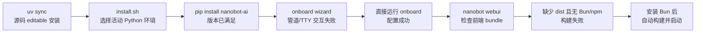

# M01 · Ch00 · L02｜安装脚本、TTY 与 WebUI 构建

> 学习日期：2026-08-24<br>
> 上一节：[L01 安装与首次运行](01-安装与首次运行.md) · [返回 Ch00](README.md) ·
> 下一节：[L03 Editable 安装边界内化](03-Editable安装边界内化.md)

## 本次核心问题

为什么 `install.sh` 把 NanoBot 安装到当前 `.venv`，为什么安装结束后向导报错，以及为什么
源码方式运行 WebUI 需要 Bun 或 npm？

## 结论先行

这次不是一个故障，而是三个连续、彼此独立的阶段：



## 1. 安装脚本为什么选择项目 `.venv`

安装脚本没有检查当前工作目录是否为 NanoBot 源码仓库。它首先固定：

```text
package=nanobot-ai
install_target=nanobot-ai
install_source=PyPI
```

随后按 PATH 查找 Python，并通过 `sys.prefix != sys.base_prefix` 判断该 Python 是否来自虚拟
环境。如果是，就执行：

```text
当前 Python -m pip install --upgrade nanobot-ai
```

本次 `which python` 已经指向 NanoBot 项目的 `.venv/bin/python`，所以脚本选择这个环境是
预期行为。源码见
[`scripts/install.sh`](https://github.com/HKUDS/nanobot/blob/9807e9cf37a5f5dcfad9dd86276dbda56e5363da/scripts/install.sh#L4-L6)
和[活动虚拟环境分支](https://github.com/HKUDS/nanobot/blob/9807e9cf37a5f5dcfad9dd86276dbda56e5363da/scripts/install.sh#L131-L137)。

## 2. 为什么显示 Requirement already satisfied

`uv sync` 已经根据 `pyproject.toml` 同步依赖，并把当前项目以 editable 方式放进 `.venv`。
安装脚本随后请求安装同名、同版本的 `nanobot-ai 0.3.0`，pip 因此判断需求已经满足。

堆栈中的 NanoBot Python 文件来自源码 checkout，而第三方包来自 `.venv/site-packages`，这正
是 editable 安装的典型形态：项目源码不复制进 site-packages，但依赖和 console script 在
虚拟环境中。

因此，“项目自动发现不是源码安装并补齐依赖”这个解释不成立。实际顺序是：`uv sync`
已经完成源码环境准备；安装脚本只是再次请求安装 PyPI 包，pip 没有重复安装。

## 3. 第一个错误：Setup Wizard 的交互输入

安装阶段已经成功，日志明确打印了 NanoBot 版本。错误发生在随后自动启动的
`onboard --wizard`。

管道命令使安装脚本的标准输入首先承载脚本文本。脚本尝试把向导输入重定向到
`/dev/tty`，但本次 `prompt_toolkit` 仍无法为文件描述符 0 注册终端读取器，最终产生
`OSError`、`EOFError`，并丢弃配置变更。

这解释了为什么直接在正常交互终端中运行 onboard 可以成功：Python 包没有坏，变化的是
交互输入边界。相关分支见
[`install.sh` 的向导启动逻辑](https://github.com/HKUDS/nanobot/blob/9807e9cf37a5f5dcfad9dd86276dbda56e5363da/scripts/install.sh#L298-L319)。

> 额外副作用：选择 onboard 的 overwrite 会重置现有配置。除非确实希望清空设置，否则
> 后续应先理解 refresh 与 overwrite 的差异。

## 4. 第二个错误：源码 checkout 缺少 WebUI bundle

发布到 PyPI 的 Wheel 会携带构建好的 `nanobot/web/dist`，普通使用者通常不需要 Bun。
但 editable 源码安装会故意跳过 WebUI bundle 构建，以免每次 Python 开发安装都触发昂贵
的前端构建。源码说明见
[`hatch_build.py`](https://github.com/HKUDS/nanobot/blob/9807e9cf37a5f5dcfad9dd86276dbda56e5363da/hatch_build.py#L51-L58)。

`nanobot webui` 在源码 checkout 中会检查：

1. 是否存在 `webui/package.json`。
2. 是否存在 `nanobot/web/dist/index.html`。
3. WebUI 源码是否比已有 bundle 更新。

当 bundle 缺失或过期时，它选择 PATH 中第一个可用的 `bun` 或 `npm`，然后自动执行依赖
安装和生产构建。两者都不存在时，才产生附件中的错误。实现见
[`nanobot/webui/build.py`](https://github.com/HKUDS/nanobot/blob/9807e9cf37a5f5dcfad9dd86276dbda56e5363da/nanobot/webui/build.py#L184-L212)。

所以：

- 对当前源码 checkout，安装 Bun 是合理选择，但 npm 也可以。
- 安装 Bun 后，重新运行 `nanobot webui` 就有能力自动执行 `bun install` 和
  `bun run build`。
- 手动先运行 `bun install` 不是唯一必要步骤；如果手动构建，完整动作还包括
  `bun run build`。
- 如果使用带预构建 bundle 的正式 PyPI Wheel，通常不需要本地前端构建工具。

## 5. 本次行为证据

- 项目 Python：`.venv/bin/python`。
- 安装器输出：检测到活动虚拟环境。
- pip 输出：`nanobot-ai 0.3.0` 已满足。
- 安装后错误：发生在 `onboard --wizard` 的终端输入层。
- 直接 onboard：成功保存配置。
- WebUI 错误：bundle 缺失且 Bun/npm 不在 PATH。
- 安装 Bun 后：`nanobot webui` 成功启动。

本公开笔记不记录本地 Provider 地址、密码或其他环境凭据。

## 6. 尚待学习者内化

请用自己的语言回答，不复述本文原句：

1. 为什么 `which nanobot` 指向 `.venv/bin/nanobot`？
2. 为什么 `uv sync` 后再运行安装脚本没有重新安装一遍全部依赖？
3. 为什么向导错误不能证明安装失败？
4. 为什么 PyPI 用户可能不需要 Bun，而源码学习者需要 Bun 或 npm？

## 7. 为什么这样设计

### 安装器优先使用活动虚拟环境

这样可以避开 macOS/Linux 的 system Python 限制，并让用户明确控制依赖隔离范围；代价是
用户如果无意中激活了别的环境，NanoBot 也会被安装到那个环境。

### Editable 安装跳过 WebUI bundle

Python 开发循环不应每次都执行 TypeScript/Vite 构建。将前端构建推迟到 WebUI 启动或
前端开发流程，可以显著缩短 Python 依赖同步时间；代价是源码首次运行多一个前端工具链
要求。

### Wheel 携带预构建 WebUI

普通用户可以只安装 Python 包并直接打开界面，不必理解 Node/Bun；构建复杂度由发布流程
承担，而不是转嫁给最终用户。

## 8. 本节涉及的核心元能力

### Shell 进程与 TTY

管道不仅传递文本，也改变进程的标准输入来源。安装完成后的交互程序可能因为没有稳定的
TTY 而失败。

### Python 环境分层

解释器、site-packages、console script、editable 源码路径和当前工作目录是五个相关但不
等价的概念。

### 构建时依赖与运行时依赖

Bun/npm 用于把 React/TypeScript 源码构建成静态 bundle；浏览器和 Gateway 使用的是构建
产物，而不是直接执行 TypeScript 源文件。

### 故障分层

长日志应先按阶段切分。安装成功、配置向导失败、前端 bundle 缺失可以连续出现，但它们
分别属于包安装、终端交互和前端构建三个不同所有者。
