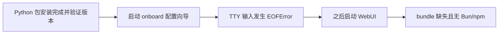
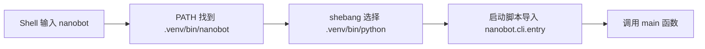

# M01 · Ch00 · L04｜运行基线复习与 CLI 启动链

> 学习日期：2026-08-25<br>
> 上一节：[L03 Editable 安装边界内化](03-Editable安装边界内化.md) · [返回 Ch00](README.md) ·
> 下一节：[L05 Typer、TUI 与公开入口](05-Typer-TUI与公开入口.md)

> 本日志采用“完成一个小闭环就落盘”的方式维护，并已在跨日学习结束后整理最终骨架、
> “为什么这样设计”和“核心元能力”。

> 跨日说明：8 月 25 日完成复习与 console-script 启动链；Typer、TUI、Gateway 和公开入口
> 的后续学习记录在 [L05 Typer、TUI 与公开入口](05-Typer-TUI与公开入口.md)。

## 今日目标

1. 闭卷复习源码 editable 安装、PyPI 安装和 WebUI 构建边界。
2. 复习 Git commit 与 package version、Shell 重定向和 TTY。
3. 完成第 00 章剩余的 CLI、Gateway、API、WebUI 公开入口观察。
4. 找到 `nanobot` 命令进入 Python 的 entry point。

## 当前学习地图


## 已完成闭环一：两种安装形态

### 主动回忆结果

- `uv sync` 从当前仓库源码同步项目，目标是项目 `.venv`。
- `install.sh` 声明从 PyPI 获取 `nanobot-ai`，目标是它检测到的活动 Python 环境。
- `Requirement already satisfied` 是安装器检查后的结果，不是安装来源或目标。

### 证据链

源码环境执行 `uv pip show nanobot-ai`，可以看到 editable project location；
`nanobot_ai-*.dist-info/direct_url.json` 进一步记录：

```json
{"url":"file://<project>/nanobot","dir_info":{"editable":true}}
```

其中 `url` 证明来源是当前仓库，`dir_info.editable` 证明安装形态是 editable。

另一个虚拟环境中的普通 PyPI 安装没有 `direct_url.json`，导入位置落在该环境的
`site-packages/nanobot/__init__.py`。使用两个绝对解释器运行 `print(nanobot.__file__)` 后，
预测与实际结果一致：源码环境导入仓库文件，PyPI 环境导入 site-packages 文件。

### 本次纠偏

- `.venv/...` 是相对于当前工作目录的路径，不一定就是当前激活环境。
- `uv pip show`、`pwd`、`VIRTUAL_ENV` 和绝对解释器路径应组合使用，避免检查了两个不同环境。
- “已存在的 nanobot 包”不是安装目标；Python 环境才是安装目标，包是其中的安装结果。

## 已完成闭环二：三个连续但独立的阶段



- A 属于 Python 包安装阶段。安装器先输出已安装信息并运行 `nanobot --version`；
  `uv pip show` 是事后状态证据。
- B 属于一次性的 onboard 配置向导，不是服务启动。
- `EOFError` 发生在 `prompt_toolkit` 尝试读取交互输入时，不会撤销已经完成的包安装。
- C 属于前端构建阶段。源码 editable 环境缺少 WebUI bundle，并且 PATH 中没有 Bun/npm，
  才导致构建失败。
- PyPI Wheel 通常携带预构建的前端产物；editable 模式跳过昂贵的 WebUI bundle 构建，
  需要时再由 Bun 或 npm 完成。

### 本次纠偏

- 代码中存在 `run_nanobot webui --yes` 不代表本次执行经过该分支；必须同时检查 `if` 条件
  和实际日志。
- 本次日志进入的是 `onboard --wizard` 分支，不能把 Setup Wizard 错误归到 WebUI。

## 已完成闭环三：Git commit 与 package version

- `pyproject.toml` 中的版本可以继续保持 `0.3.0`，同时仓库源码继续产生 commit 或本地修改。
- package version 表达发布语义，Git commit 标识一份具体源码。
- 两个环境都显示 `0.3.0`，不代表代码和依赖必然相同。
- 精确复现源码时应同时记录 package version 和 Git commit，其中 commit 是锁定源码的必要
  标识。

当前只能推断源码与 PyPI Wheel 的依赖差异来自不同代码状态；若要证明，需要比较发布 tag、
Wheel 元数据和当前 commit。

## 已完成闭环四：Shell 最小模型与 TTY

Shell 的 `if command; then` 通常根据命令退出码分支：`0` 表示成功，非 `0` 表示失败。

标准流：

| 文件描述符 | 名称 | 默认用途 |
|---:|---|---|
| 0 | stdin | 读取输入 |
| 1 | stdout | 输出正常结果 |
| 2 | stderr | 输出错误信息 |

重定向关系：

| 写法 | 等价关注点 | 数据方向 |
|---|---|---|
| `< file` | `0< file` | file → stdin → command |
| `> file` | `1> file` | command → stdout → file |
| `2> file` | stderr | command → stderr → file |

TTY 是程序与交互式终端之间的接口。`[ -t 0 ]` 检查 stdin 是否连接终端；
`run_nanobot onboard --wizard < /dev/tty` 由 Shell 把 `/dev/tty` 连接到命令的 stdin。

### 本次纠偏

- `< /dev/tty` 改变的是 stdin，不是 stdout。
- 更准确的表述不是“文件把内容输出到命令”，而是 Shell 打开文件或设备，并把它连接到
  命令的文件描述符 0。

## 已完成：CLI entry point

### 已完成：Shell 到 Python entry point

学习前预测 `.venv/bin/nanobot` 可能是编译后二进制。通过 `file`、`which`、读取启动文件和
`pyproject.toml` 后，确认实际调用链为：



`pyproject.toml` 中的声明是：

```toml
[project.scripts]
nanobot = "nanobot.cli.entry:main"
```

等号左边是安装后暴露给 Shell 的命令名；右边采用 `Python 模块:可调用对象` 格式，指定
Python 入口。包管理工具安装项目时据此生成 `.venv/bin/nanobot` 这个很短的 console-script
启动文件。

本次纠偏是区分三种不同证据：

- `which nanobot` 回答 PATH 找到了哪个命令文件。
- 启动文件第一行的 `#!...` 回答内核应使用哪个解释器运行它。
- `[project.scripts]` 回答 Python 应导入哪个模块并调用哪个函数。

`#!<python-path>` 是启动文件的内容，不是 PATH 的查找结果。

- [x] 找到 `nanobot` console script 的声明位置。
- [x] 找到它进入的 Python 函数。
- [x] 在次日延续学习中区分 CLI、Gateway、API、WebUI 的用途。
- [x] 在次日延续学习中画出四个公开入口与共享运行时能力的关系。

## 为什么这样设计

### 为什么用 console script 连接 Shell 与 Python

`[project.scripts]` 让包管理工具为不同虚拟环境生成正确的启动文件与 shebang。项目只维护
`module:function` 映射，不需要手工编写和同步每个平台的启动器。

### 为什么先建立证据链再读实现

解释器、命令文件、导入路径、包元数据和当前目录彼此相关但不等价。按 PATH、shebang、
entry point 和 import path 分层验证，可以避免把环境错误归因给业务代码。

### 为什么安装、向导与前端构建必须分层

三个阶段由不同模块负责，也有独立的成功/失败状态。后续阶段失败不会自动回滚前面已经
完成的阶段；先按阶段切日志，才能选择正确修复动作。

## 本节涉及的核心元能力

### 主动回忆与证据校准

先脱稿回答，再通过命令输出纠偏。`uv pip show`、`direct_url.json`、绝对解释器和
`nanobot.__file__` 分别回答不同问题，不能用单条输出替代整条证据链。

### Shell 与操作系统基础

掌握 PATH、shebang、退出码、stdin/stdout/stderr、重定向和 TTY 的最小模型，足以阅读
安装脚本和诊断交互程序。

### Python 打包入口

理解 `[project.scripts]` 的 `命令名 = "module:function"` 映射，以及 editable 安装如何让
虚拟环境引用工作区源码。
