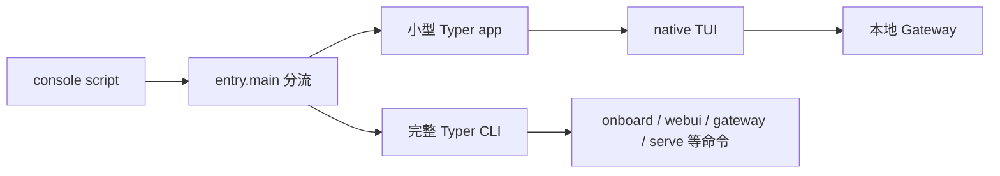
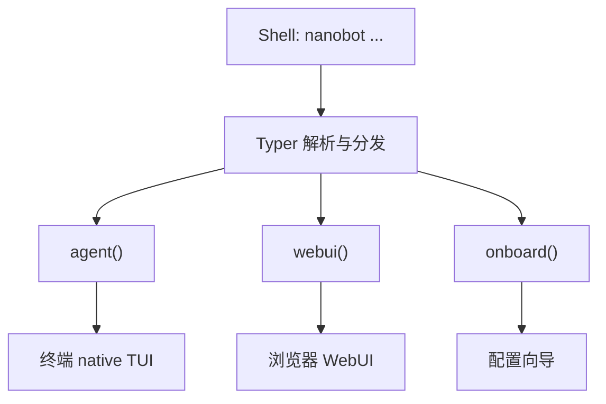
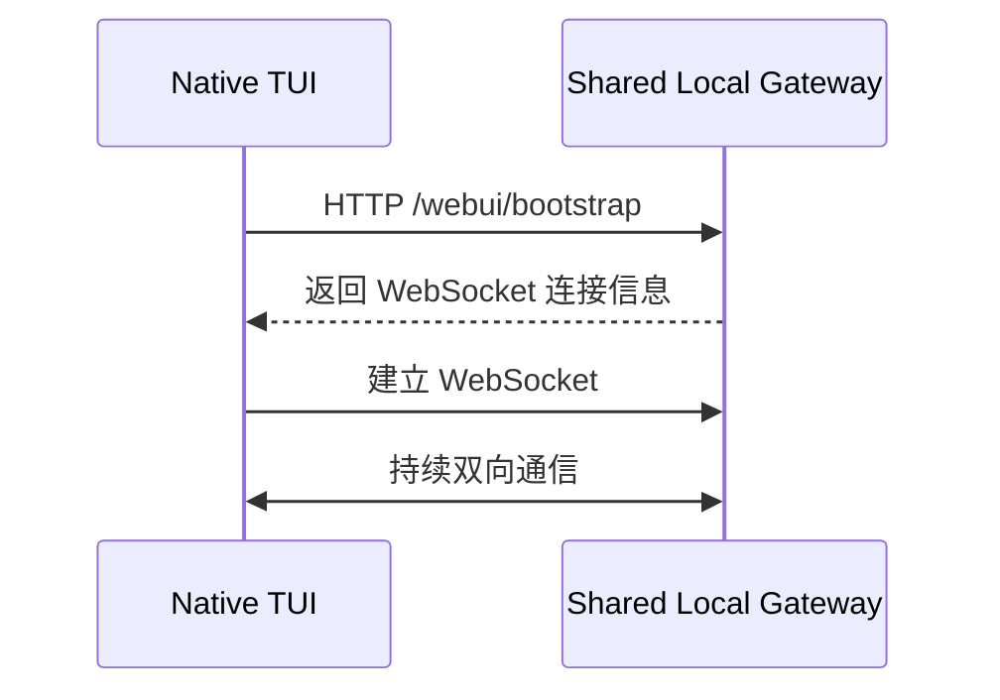
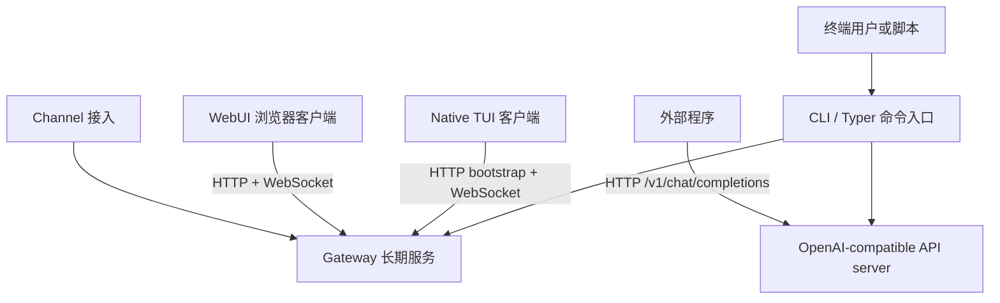

# M01 · Ch00 · L05｜Typer、TUI 与公开入口

> 学习日期：2026-08-26<br>
> 上一节：[L04 运行基线复习与 CLI 启动链](04-运行基线复习与CLI启动链.md) ·
> [返回 Ch00](README.md) · [返回 M01](../README.md)

> 延续 [L04 运行基线复习与 CLI 启动链](04-运行基线复习与CLI启动链.md)。
> 本日志采用“完成一个小闭环就落盘”的方式维护，并已在第 00 章验收后完成整理。

## 今日目标

1. 理解 `nanobot.cli.entry:main` 为什么区分轻量路径与完整 CLI graph。
2. 区分 Typer、native TUI 与 WebUI。
3. 识别 native TUI 如何连接本地 Gateway。
4. 完成 CLI、Gateway、API、WebUI 四个公开入口的职责地图。

## 当前学习地图



## 已完成闭环一：轻量入口与完整 CLI graph

`entry.main()` 检查 `sys.argv[1:]`。本次已正确判断：

| 命令 | `_native_tui_candidate` | 分支 |
|---|---:|---|
| `nanobot agent` | `True` | 轻量 native TUI 路径 |
| `nanobot webui` | `False` | 完整 Typer CLI |
| `nanobot onboard` | `False` | 完整 Typer CLI |

轻量路径不是“不使用 Typer”，而是临时创建一个只注册 `agent` 的小型 Typer app；完整路径
导入 `nanobot.cli.commands.app`，其中注册了完整命令图。

把大型模块导入写在分支内部属于按需加载/延迟导入。这里主要减少启动前的模块导入、命令
注册和相关初始化工作，而不是减少 TUI 已经启动后的渲染成本。

### 本次纠偏

- CLI 是整个命令行入口；TUI 是 CLI 下的一种终端交互方式，两者不是反义词。
- `_native_tui_candidate=True` 进入轻量路径；`False` 才落到完整 Typer app。第一次回答时将
  两条路径整体对调，随后通过 `if` 代码块、`fast_app` 和 `return` 修正。

## 已完成闭环二：Typer、TUI 与 WebUI

### Typer

Typer 是 Python 命令解析与分发框架。它负责识别子命令、解析和校验选项、生成帮助，并调用
注册的 Python 函数。它不负责渲染浏览器页面。

### Native TUI

Native TUI 是显示在终端里的 TypeScript 交互客户端。`nanobot agent` 的特定交互形式会经
小型 Typer app 调用 `agent()`，再由 `tui_launcher.py` 启动 TUI 进程。

### WebUI

WebUI 是浏览器中的 React 页面。`nanobot webui` 先由完整 Typer CLI 分发到 `webui()`，
后续逻辑负责准备配置、Gateway、前端 bundle 和浏览器入口；Typer 本身不渲染页面。



## 已完成闭环三：TUI 与 Gateway 的通信边界

`tui_launcher.py` 向 TUI 进程传入 `NANOBOT_TUI_BOOTSTRAP_URL` 和
`NANOBOT_TUI_API_URL`。环境变量只是保存地址，不是处理请求的服务。



最终形成的表述：native TUI 显示在终端；它访问环境变量所指向的共享本地 Gateway，调用
bootstrap 接口取得连接信息，随后通过 WebSocket 与 NanoBot 后端持续通信。

### 本次纠偏

- `NANOBOT_TUI_BOOTSTRAP_URL` 是配置值，不是服务实体。
- HTTP bootstrap 用来取得连接信息；持续双向通信使用 WebSocket。

## 已完成：四个公开入口

### 已完成：入口、角色、生命周期与协议

本次先后区分了四个容易混用的维度：

| 入口/组件 | 角色 | 主要使用者或接入方 | 典型生命周期 |
|---|---|---|---|
| CLI | 命令解析与分发入口 | 终端用户、脚本 | 取决于子命令：可以一次性、交互式或启动长期服务 |
| Gateway | 共享后端服务 | TUI、WebUI、各类 Channel | 长期运行 |
| OpenAI-compatible API | HTTP 服务 | 外部 Python/JavaScript 程序等 | server 长期监听；单次请求是独立的请求—响应过程 |
| WebUI | 浏览器客户端/显示层 | 浏览器用户 | 页面会话存续期间运行，后端生命周期与页面分离 |

WebSocket 是 Gateway 支持的持续双向通信协议之一，不是客户端、后端或生命周期。



### 本次纠偏

- CLI 本身没有统一生命周期；生命周期由它分发的子命令决定。
- Gateway 并非只服务远程电脑；本地 native TUI 就依赖共享本地 Gateway。
- API server 的生命周期与单次 HTTP 请求的生命周期不同：前者持续监听，后者相对短暂。
- WebSocket 是通信协议，不是 Gateway 的生命周期、后端或客户端。
- WebUI 是浏览器客户端；`nanobot webui` 是启动/准备该体验的 CLI 命令，两者不是同一个
  抽象层级。

- [x] 找到 `nanobot` console script 与 Python entry point。
- [x] 理解 Typer、native TUI 与 WebUI 的关系。
- [x] 确认 native TUI 通过本地 Gateway/WebSocket 通信。
- [x] 区分 CLI、Gateway、OpenAI-compatible API、WebUI 的用户与用途。
- [x] 画出四个公开入口与共享运行时能力的完整关系图。

## 最终脱稿验收

经过闭卷回忆、位置提示和术语绑定后，最终形成以下启动链：

```text
Shell → PATH → .venv/bin/nanobot → shebang → 项目 Python
→ nanobot.cli.entry:main → 轻量 native TUI / 完整 Typer CLI
```

四入口角色：

- CLI：命令解析与分发入口。
- Gateway：共享的长期后端服务。
- OpenAI-compatible API：供外部程序调用的 HTTP 服务。
- WebUI：浏览器客户端与显示层。

轻量 `agent` 路径的设计目标是减少启动前的模块导入和命令注册，不是减少后端服务数量。

## 最小测试验证

阅读并运行：

```bash
uv run pytest tests/cli/test_entry.py -v
```

结果：`2 passed, 1 warning in 0.10s`。

测试锁定的行为：

| 入口 | 参数案例 |
|---|---|
| 轻量 native TUI | `["agent"]`、`["agent", "--session", "websocket:chat"]`、`["agent", "--theme=light"]` |
| 完整 Typer CLI | `agent --classic`、`agent -m ...`、`agent --message=...`、`status` |

运行前曾将案例分组填反；随后根据 `assert candidate(...)` 与
`assert not candidate(...)` 的布尔语义完成纠偏。

警告为当前环境未识别 `asyncio_mode` 配置。它不影响这两个同步测试；异步测试环境检查已
进入停车场，本章不扩展处理。

## 为什么这样设计

### 为什么轻量路径仍使用 Typer

参数解析、类型校验和帮助生成仍需要统一框架；只注册 `agent` 可以保留一致行为，同时避免
加载完整命令图。

### 为什么 TUI 和 WebUI 共享 Gateway

显示层可以独立演进，长期运行状态和 Channel 接入集中在共享后端。关闭某个客户端不会
要求立即销毁整个运行时。

### 为什么 API server 与 Gateway 分开理解

两者都可能长期运行，但服务契约不同：API 面向 OpenAI-compatible HTTP 调用，Gateway
承载共享运行时、Channel 和客户端连接。按契约区分，才能选择正确入口。

### 为什么用测试锁定入口分流

命令行参数组合容易在重构时改变。小型纯函数测试能快速保证交互式 agent 继续走轻量入口，
而一次性、classic 和其他命令仍进入完整 CLI。

## 本节涉及的核心元能力

### 延迟导入

把 import 放在运行分支内，使未选择的功能不承担导入和初始化成本。

### 概念类型检查

客户端、服务端、协议、环境变量和生命周期属于不同维度。WebSocket 是协议，Gateway 是
服务，TUI/WebUI 是客户端，URL 环境变量只是配置值。

### 进程与请求生命周期

长期运行的 server 可以处理多个短暂请求；浏览器页面结束也不等于共享 Gateway 必须退出。

### 测试即行为规范

测试名称、输入案例、`assert` 与 `assert not` 共同描述入口选择规则。运行测试之前先预测，
可以暴露“会运行命令”和“理解行为”之间的差距。
