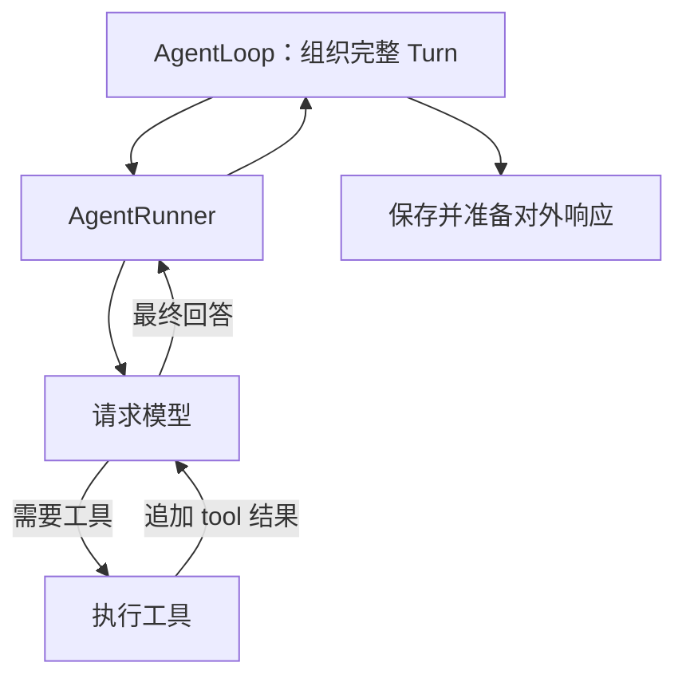

# M01 · Ch01 · L01｜AgentLoop 与 AgentRunner 职责边界

> 学习日期：2026-08-27 · [返回 Ch01](README.md)

## 本次只解决一个问题

模型要求调用工具并在获得结果后再次推理时，谁负责“模型 → 工具 → 模型”的重复过程？

## 开始前预测（学习者原话）

> AgentRunner 是驱动大模型的入口，他的输出结果是思考、普通回答、工具请求、工具调用、
> 工具返回结果，底层应该遵循 OpenAI 的接口规范，分为不同角色。
>
> “模型 → 工具 → 模型”的重复过程由 AgentLoop 负责，AgentLoop 应该就是负责持续驱动大模型。

这个预测已经识别出 Runner 与模型、工具的紧密关系，但把“完整 Turn 的组织者”与“内部
迭代的执行者”混在了一起。

## 最小证据集

| 文件/符号 | 证据 |
|---|---|
| `nanobot/agent/loop.py::_process_message` | 依次执行 restore、compact、command、build、run、save、respond |
| `nanobot/agent/loop.py::_run_turn` | 在完整 Turn 的 run 阶段启动内部 agent loop |
| `nanobot/agent/loop.py::_run_agent_loop` | 调用 `self.runner.run(AgentRunSpec(...))` |
| `nanobot/agent/runner.py::_run_core` | 使用 `for iteration in range(...)` 驱动多轮模型调用 |
| `nanobot/agent/runner.py::_execute_tools` | 执行模型请求的工具，把 tool 结果追加回消息后继续下一轮 |

## 校正后的模型

- `AgentLoop` 管理完整 Turn 的产品级生命周期。
- `AgentRunner` 管理模型调用、工具执行与再次调用模型的内部循环。
- 工具调用请求通常附在 assistant 消息中；工具结果使用 `tool` 角色。工具调用本身不是一个
  独立消息角色。
- Runner 使用 NanoBot 的统一内部结构；不同 Provider 是否使用 OpenAI 接口留到 Provider
  章节再展开。

## 迁移验证（学习者原话）

> 由 AgentLoop 负责，它负责了请求以外的所有事情，会话、记忆、重拾、插件、skills 等功能。

职责方向正确。进一步收紧：不能概括为“Runner 只管请求，其余全部归 Loop”，因为工具执行
也在 Runner 内；Session 恢复、上下文构建、保存和输出组装属于 Loop。

## 为什么这样设计

### 为什么分成外层 Turn 与内层执行循环

Session、持久化和输出投递是产品生命周期问题；模型与工具的交替执行是推理运行问题。
分开后，Runner 可以复用执行能力，而 Loop 可以独立处理 Channel、Session 和交付语义。

### 为什么 Runner 使用最大迭代次数

模型可能连续请求工具。显式循环和迭代上限既允许多步任务，也避免模型—工具循环无限运行。

## 本节核心元能力

### 职责边界

区分“谁组织完整业务流程”与“谁执行其中可重复的内部算法”。

### 用控制流验证命名

类名和注释只能给出线索；真正的职责要由调用关系、循环位置和副作用证明。

## 记忆分层

- **A：内化**：AgentLoop 管完整 Turn；AgentRunner 管模型—工具内部循环。
- **B：会定位**：`_process_message`、`_run_turn`、`AgentRunner._run_core`。
- **C：可查阅**：精确行号、`AgentRunSpec` 字段和 Hook 调用顺序。

## 下一次五分钟内可启动的动作

阅读 `_process_message` 中连续的七个 `_run_turn_stage(...)`，先只为每个阶段写一个动词。

