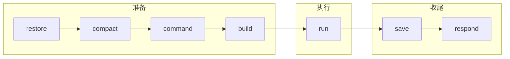
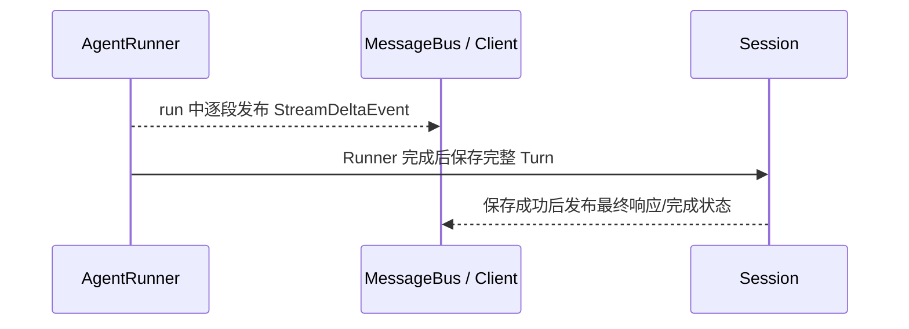

# M01 · Ch01 · L02｜AgentLoop 七阶段与流式边界

> 学习日期：2026-08-27 · [返回 Ch01](README.md)

## 本次只解决一个问题

`AgentLoop._process_message()` 如何组织一次正常 Turn，以及流式显示与最终保存是什么关系？

## 七阶段骨架

A 层只需保留：**恢复与准备 → 执行 → 保存与回复**。七个精确英文名称属于 B 层。

| 阶段 | 当前含义 |
|---|---|
| restore | 取得 Session，恢复检查点和待处理输入 |
| compact | 在构建模型输入前控制历史规模 |
| command | 尝试无需模型的本地命令，命中后可短路 |
| build | 选择运行配置并构建初始消息 |
| run | 启动 Runner 的模型—工具循环 |
| save | 将完整 Turn 持久化到 Session |
| respond | 准备最终对外消息；之后由 delivery 完成投递生命周期 |

## 学习者的因果判断

### command 为什么能够短路

> 因为本次操作不需要请求大模型，本次操作可以从会话的上下文历史中得出。

第一句正确。第二句收紧为：本地命令可以从本地运行状态、配置、Session 元数据或历史等来源
构造结果，根本原因是不需要构建模型输入或启动 Runner。

### restore 为什么早于 build

> 本次会话可能在之前有过记录，我们不能丢失历史上下文；如果顺序反过来，模型会在什么都
> 不知道的情况下回答，而本次问题很可能基于历史上下文。

核心因果正确。更精确地说，当前消息仍可能存在，但历史、Session、检查点或 Provider 状态
可能缺失。

### compact 为什么位于 restore 与 build 之间

> 可能超过模型的总上下文 Context，所以必须压缩历史上下文。

正确。`compact` 先取得 Session 后检查其规模，并在构建模型输入前把历史控制在预算内；它
不表示每一轮必然发生实际压缩。

## 流式显示不是保存后重播

学习者追问：

> 难道流式输出过程中我们是先流式拿完所有结果，然后再保存后重新流式输出吗？如果是这样，
> 报错可以立马丢弃输出内容，然后重试？

答案是否定的：

已经发布到客户端的流式内容无法撤回。错误发生后可以关闭流、显示错误，或由特定恢复逻辑
处理，但不能假装用户从未看到此前内容。

学习者也正确推断：如果用户看到回答而最终 Session 保存失败，下一轮可能缺少上一轮回答或
工具结果，出现上下文断裂。详细 checkpoint、流恢复与 Turn Delivery 推迟到 Ch11。

## 为什么这样设计

### 为什么命令在模型运行前短路

避免为本地确定性操作支付模型延迟、Token 成本和失败风险，同时仍能复用 Session 与统一输出。

### 为什么先控制历史再构建输入

构建后的消息才是模型真正看到的输入。压缩若发生得更晚，无法保护本次请求的上下文预算。

### 为什么区分实时显示与最终提交

实时流降低用户等待感；最终保存保证下一轮能够延续。两者目标不同，因此需要显式的生命周期
和错误恢复边界。

## 本节核心元能力

### 数据依赖排序

根据后一步需要哪些状态，解释阶段为什么必须按当前顺序排列。

### 可见状态与持久状态

界面已经显示不等于数据已经可靠提交；数据库事务、消息队列和文件保存也存在相同边界。

## 记忆分层

- **A：内化**：准备 → Runner 执行 → 持久化 → 完成；流式显示与持久化是两条相关但不同的路径。
- **B：会定位**：`_process_message`、`_persist_turn`、`_prepare_outbound`、`TurnDelivery`。
- **C：可查阅**：七个处理函数的精确名称、Stream 事件类型、checkpoint payload。

## 下一次五分钟内可启动的动作

先预测 `test_runner_preserves_reasoning_fields_and_tool_results` 应保护哪条模型—工具—模型行为，
再由学习者运行这一个测试。

