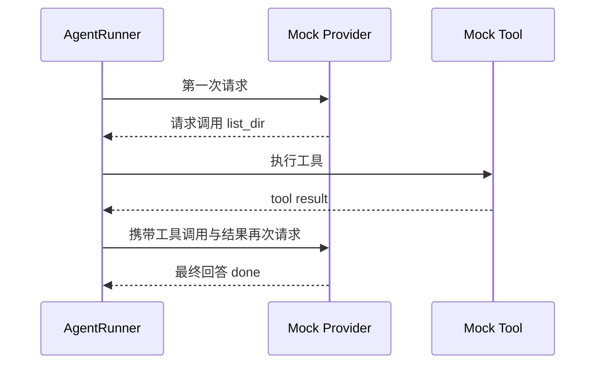

# M01 · Ch01 · L03｜聚焦测试与端到端验收

> 学习日期：2026-08-27 · [返回 Ch01](README.md)

## 本次只解决一个问题

如何用一个最小测试证明 `AgentRunner` 确实执行了“模型 → 工具 → 模型”循环？

## 运行前预测（学习者原话）

> Mock Provider 应该被调用 2 次。
>
> 消息列表里应该比第一次多出一个工具的请求和一个工具的响应，共两个。

预测正确。更精确地说，新增的是携带 `tool_calls` 的 assistant 消息和 `role="tool"` 的
工具结果消息。

## 测试流程



执行：

```bash
uv run pytest \
  tests/agent/test_runner_core.py::test_runner_preserves_reasoning_fields_and_tool_results \
  -v
```

结果：

```text
collected 1 item
tests/agent/test_runner_core.py::test_runner_preserves_reasoning_fields_and_tool_results PASSED
1 passed in 0.08s
```

环境中的 `pytest-asyncio` 已通过 `uv sync --extra dev` 补齐，原来的 `asyncio_mode` 未识别
警告不再出现。

## 测试证明了什么

- Runner 收到工具请求后会执行对应工具。
- 工具调用请求与工具结果会进入下一次模型请求。
- 模型第二次返回普通回答后，Runner 结束内部循环。
- 结果记录最终内容、使用过的工具和工具事件。
- assistant 的 reasoning 字段与 thinking blocks 没有在循环中丢失。

## 测试没有证明什么

- 没有连接真实 Provider 或真实 `list_dir` 工具。
- 没有覆盖完整 `AgentLoop` 的 restore、compact、save、respond。
- 没有证明 Session 文件、MessageBus 投递或客户端流式显示正确。
- 没有证明 Runner 的所有错误与恢复分支。

## 为什么这样设计

### 为什么使用 Mock Provider

这个测试关心 Runner 如何处理响应，不关心网络、凭据和具体模型。Mock 能提供确定的两次
响应，让失败直接指向控制流。

### 为什么检查第二次请求的消息

只检查最终回答 `done` 可能掩盖工具结果没有真正交还模型的问题。检查消息链才能证明循环
中间状态正确。

## 本节核心元能力

### 运行前预测

先声明预期，再看测试结果，才能区分“测试通过了”与“我理解了它为何通过”。

### 证据边界

一个测试只证明它实际构造和断言的行为，不把局部 Mock 测试扩大成整个系统正确。

## 记忆分层

- **A：内化**：工具结果必须回到消息链，模型才能基于它继续推理。
- **B：会定位**：`test_runner_preserves_reasoning_fields_and_tool_results` 与 `AgentRunner._run_core`。
- **C：可查阅**：Mock 字段、完整断言和精确运行耗时。

## 下一次五分钟内可启动的动作

进入 Ch02，只读 `MessageBus` 的两个队列和四个方法，预测它为什么不直接调用 AgentLoop。

