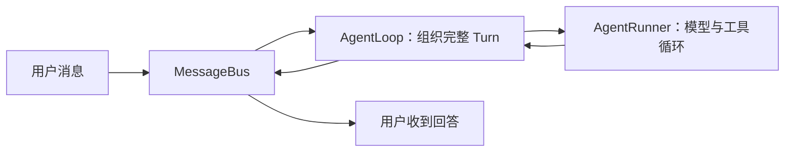

# NanoBot 第 01 章：一次完整 Agent Turn

> 课程位置：[M01 最小闭环](../README.md) → Ch01 · 顺序 02

## 本章只解决一个问题

用户发送一条消息后，NanoBot 如何把它变成最终回答？

## 本章术语

- `MessageBus`：传递输入和输出消息。
- `AgentLoop`：组织一次 Turn 的产品级生命周期。
- `AgentRunner`：执行模型与工具的内部迭代。

## 黑盒边界

本章观察端到端主干和职责边界。Session、Context、Provider、Tool、Hook 与并发控制只标出
位置，不展开内部实现。

## 小节顺序

| 顺序 | 小节 | 状态 | 核心产物 |
|---:|---|---|---|
| L01 | [AgentLoop 与 AgentRunner 职责边界](01-AgentLoop与AgentRunner职责边界.md) | 已完成 | 外层 Turn / 内层执行循环图 |
| L02 | [AgentLoop 七阶段与流式边界](02-AgentLoop七阶段与流式边界.md) | 已完成 | restore → respond 阶段图 |
| L03 | [聚焦测试与端到端验收](03-聚焦测试与端到端验收.md) | 已完成 | 一次 Turn 的证据链 |

## 当前 A 层模型

`AgentLoop` 负责恢复、构建、运行、保存和输出等完整 Turn 阶段；它把模型与工具的重复执行
委托给 `AgentRunner`。Runner 返回结果后，Loop 继续完成持久化和对外响应。

## 本章完成条件

- [x] 能区分 AgentLoop 与 AgentRunner 的职责。
- [x] 能用自己的话解释一次 Turn 的七个阶段。
- [x] 能指出模型—工具—模型循环所在的源码位置。
- [x] 能运行一个聚焦测试并说明它保护的行为。
