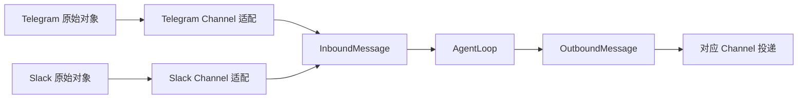

# M01 · Ch02 · L02｜Inbound 与 Outbound 事件契约

> 学习日期：2026-08-27 · [返回 Ch02](README.md)

## 本次只解决一个问题

为什么不同平台要先转换成统一事件，以及输入与输出为什么使用不同的消息类型？

## 宏观模型

## 学习者的迁移判断

### 平台 SDK 字段发生变化

> 理论上应该只修改 Slack Channel，因为 Slack Channel 负责处理 Slack 平台的消息，然后转换
> 为统一 InboundMessage 再给 AgentLoop，不能因为一个 Channel 的修改而影响 AgentLoop。

正确。Channel 是平台对象与 Agent Core 之间的适配器边界。

### Session Key 为什么组合 channel 与 chat_id

> 双重组合防止 ID 重复。

正确。更精确地说，`channel` 为 `chat_id` 提供命名空间，避免 `telegram:123` 与
`slack:123` 错误合并为同一 Session。

### 平台特有字段放在哪里

> 放进 metadata。不同平台的特有信息都放在 metadata，只有相同可以被抽出的信息才放在
> InboundMessage 顶层，这样可以保证适配器的通用性和处理不同平台的特殊性。

正确。补充边界：Agent Core 不应到处读取平台专属 metadata，否则耦合只是被藏进字典。

## 输入与输出是不同契约

- `InboundMessage` 描述发生了什么，需要发送者、输入角色、时间等输入语义。
- `OutboundMessage` 描述要投递什么，需要回复目标、按钮、显示事件等输出语义。
- 两者共享路由和内容字段，但不能因此合成一个包含大量无意义可选字段的巨型类。

学习者最初从显示差异解释两类消息：

> 输入是为了统一输入用于大模型的输入，而输出可能是多个不同客户端，例如 CLI、WebUI，
> 输出的显示效果可能不一样。

输出显示差异是原因之一。需要修正：InboundMessage 不是直接的模型输入，而是 Agent Core 的
内部输入事件；之后还会经过 Session 恢复与 Context 构建。分成两个类的首要原因是方向职责、
合法字段和不变量不同。

## 为什么这样设计

### 为什么在 Channel 边界完成转换

平台变化由最了解该平台的适配器吸收，核心只依赖稳定契约，从而支持独立演进和测试。

### 为什么不用一个巨型 Message

分开的类型让无效状态更难表达，例如输入消息不应携带输出按钮；代码阅读者也能从类型判断
数据正朝哪个方向流动。

## 本节核心元能力

### 适配器模式

在外部多样接口与内部稳定接口之间增加转换层，把变化限制在系统边界。

### 命名空间

把局部唯一 ID 与来源组合，形成跨系统唯一标识，避免不同来源的数据碰撞。

### 类型表达不变量

用不同数据类型表达不同方向的合法状态，而不是依赖调用者记住哪些字段此时可用。

## 记忆分层

- **A：内化**：Channel 吸收平台差异；Agent Core 只依赖统一事件契约；输入输出类型表达不同方向。
- **B：会定位**：`nanobot/bus/events.py` 的 `InboundMessage`、`OutboundMessage` 和 `session_key`。
- **C：可查阅**：完整字段列表、内部 metadata key 和 UI event 类型。

## 下一次五分钟内可启动的动作

编写一个最小 asyncio 实验：先启动 `consume_inbound()`，稍后 `publish_inbound()`，观察等待
中的消费者被唤醒并取得同一个消息对象。

