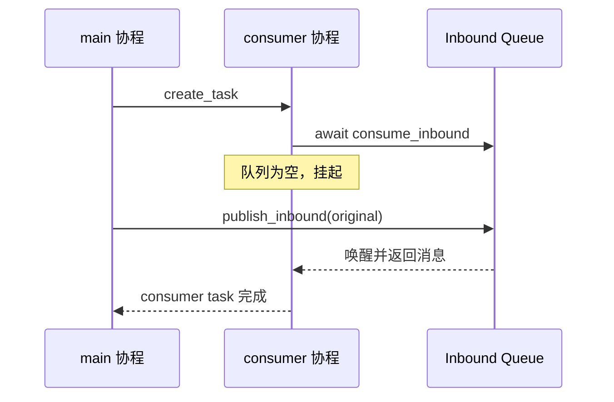

# M01 · Ch02 · L03｜队列唤醒聚焦实验

> 学习日期：2026-08-27 · [返回 Ch02](README.md)

## 本次只解决一个问题

空队列上的消费者是否会等待，并在生产者发布消息后取得这条消息？

## 实验流程



实验文件：[experiments/ch02_message_bus_wakeup.py](../../../experiments/ch02_message_bus_wakeup.py)

## 运行前预测（学习者原话）

```text
consumer waiting before publish: yes
received is original object: no
final inbound size: i dont know
```

第一项正确；后两项保留为待实验验证，而不是继续猜测。

## 实际结果

```bash
uv run python \
  /Users/comet/WorkSpace/Project/Python/nanobot-learning/experiments/ch02_message_bus_wakeup.py
```

```text
consumer: waiting
consumer waiting before publish: True
consumer: received 'hello queue'
received is original object: True
final inbound size: 0
```

## 结果解释

- `True`（等待）：空队列上的 `await get()` 挂起消费者协程。
- `True`（同一对象）：进程内的 `asyncio.Queue` 保存对象引用，不自动复制或序列化。
- `0`（最终大小）：一次 publish 增加一条，一次 consume 取走一条，队列恢复为空。

## 证据边界

这个实验只验证当前进程内 `MessageBus.inbound` 的基本行为。它没有证明：

- 跨进程或跨网络消息传输；
- 进程退出后的消息持久化；
- 有界队列、背压和高并发公平性；
- Channel Manager 与 AgentLoop 的完整集成。

## 为什么这样设计

### 为什么先让消费者进入等待

如果先发布再消费，只能证明队列能存取，不能直接观察空队列等待后被唤醒的行为。

### 为什么比较对象身份

`received is original` 区分了“内存中转交同一对象”和“经过复制/序列化生成新对象”两种
通信模型，防止把 `asyncio.Queue` 误认为网络消息队列。

## 本节核心元能力

### 最小可证伪实验

只改变并观察一条因果边：先等待，再发布，看消费者是否恢复。

### Python 引用语义

容器和队列通常持有对象引用；取出对象时不会自动得到深拷贝。

## 记忆分层

- **A：内化**：空队列挂起消费者，发布消息后唤醒；当前 MessageBus 是进程内异步队列。
- **B：会定位**：实验脚本与 `nanobot/bus/queue.py`。
- **C：可查阅**：打印顺序、`asyncio.sleep(0)` 和对象身份检查语法。

## 下一次五分钟内可启动的动作

进入 Ch03，从 `AgentLoop.run()` 只追踪 `consume_inbound()` 到 `_dispatch(msg)` 的一条边。

