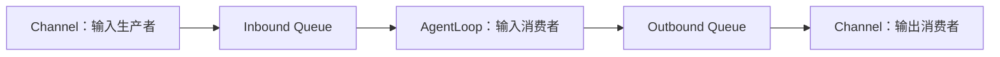

# NanoBot 第 02 章：MessageBus 与事件契约

> 课程位置：[M01 最小闭环](../README.md) → Ch02 · 顺序 03

## 本章只解决一个问题

不同 Channel 如何在不直接依赖 AgentLoop 实现的情况下传递输入和输出？

## 小节顺序

| 顺序 | 小节 | 状态 | 核心产物 |
|---:|---|---|---|
| L01 | [生产者—消费者与异步队列](01-生产者消费者与异步队列.md) | 已完成 | MessageBus 解耦图 |
| L02 | [InboundMessage / OutboundMessage 契约](02-Inbound与Outbound事件契约.md) | 已完成 | 平台无关事件地图 |
| L03 | [队列行为聚焦实验](03-队列唤醒聚焦实验.md) | 已完成 | 最小异步消息总线验证 |

## 当前黑盒边界

本章只看队列、事件对象与数据流。Channel SDK、Gateway 网络协议、AgentLoop 内部阶段和
Outbound Delivery 细节继续保持黑盒。

## 本章完成条件

- [x] 能解释 MessageBus 如何解耦生产者与消费者。
- [x] 能说明空队列上的 `await` 不阻塞整个事件循环。
- [x] 能解释 Channel 适配器与统一事件契约。
- [x] 能区分 InboundMessage 与 OutboundMessage。
- [x] 能运行最小实验并说明其证据边界。
