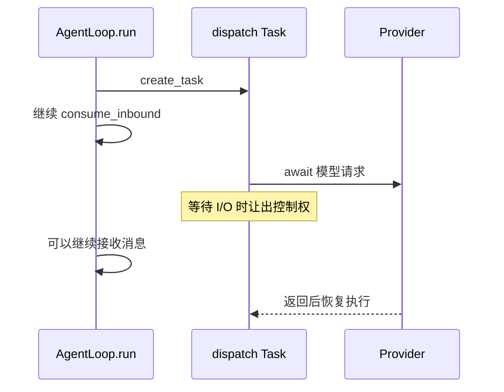

# M01 · Ch03 · L01｜create_task 与协作式并发

> 学习日期：2026-08-27 · [返回 Ch03](README.md)

## 本次只解决一个问题

为什么 `AgentLoop.run()` 使用 `create_task(_dispatch(msg))`，而不是直接等待每个 Turn 完成？

## 源码骨架

```python
msg = await self.bus.consume_inbound()
task = asyncio.create_task(self._dispatch(msg))
```



## 开始前预测（学习者原话）

> 使用 create_task(self._dispatch(msg)) 可以将 self._dispatch(msg) 作为协程挂在后台，不必
> 一直等待，可以让模型去做其他事情，底层原因是 Python 因为 GIL 锁，同一时刻只能运行一个
> Python 字节码。

前半段职责方向正确：`run()` 不等待整个 Turn，可以继续接收消息。需要修正：`create_task`
通常没有创建新线程或新进程；它把协程注册为同一事件循环中的独立 Task。主要机制是协程在
`await` I/O 时主动让出控制权，而不是 GIL 促成调度。

## CPU 密集型迁移判断

学习者正确判断：

> 不能，没有 await 就无法让出控制权。如果是一段持续十秒、没有任何 await 的纯 Python
> 计算，那么属于 CPU 密集型，需要使用多进程，也就是 Process 库。

十秒纯 Python 计算会阻塞事件循环。常见解决方式是 `multiprocessing` 或进程池；具体选择仍
取决于任务能否拆分、底层库是否释放 GIL，以及进程通信成本。

## 为什么这样设计

### 为什么不逐条 await 完整 Turn

模型和工具可能耗时很长。若 `run()` 等待它们结束，就无法及时消费下一条消息，`/stop`、
其他 Session 和运行时控制消息都会延迟。

### 为什么 create_task 不等于真正并行

多个 Task 在一个事件循环线程中协作推进；只有遇到 `await` 才有机会切换。它提高 I/O 等待
期间的并发性，不会自动让 CPU 密集型 Python 代码并行。

## 本节核心元能力

### 并发与并行

并发表示多个任务在时间上交错推进；并行表示同一时刻在多个执行单元上运行。

### I/O 密集与 CPU 密集

网络等待适合 asyncio；长时间纯计算需要移出事件循环或采用真正的并行执行策略。

## 记忆分层

- **A：内化**：create_task 让 run 不必等待 Turn；Task 通过 await 协作，不由 GIL 自动并行。
- **B：会定位**：`AgentLoop.run()` 中的 `consume_inbound()` 与 `create_task(_dispatch)`。
- **C：可查阅**：Task 集合维护、done callback、线程池和进程池 API。

## 下一次五分钟内可启动的动作

观察 `_dispatch()` 的 per-session lock，预测同一 Session 两个 Turn 并发执行会破坏什么。

