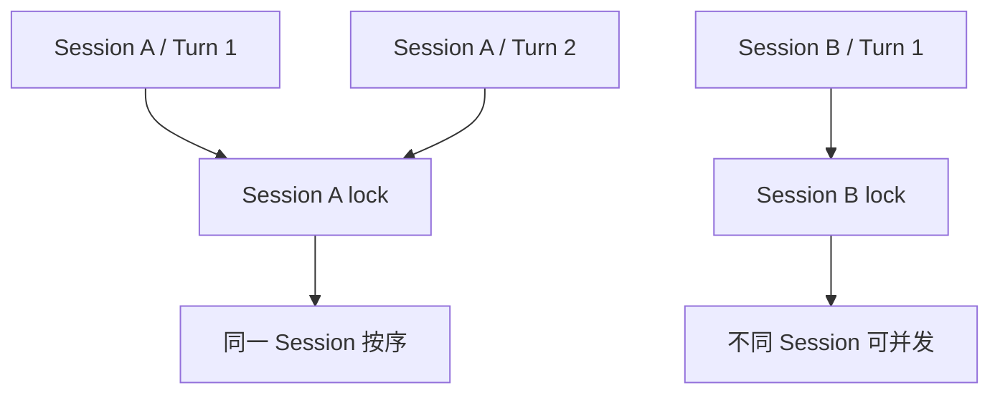

# M01 · Ch03 · L02｜Session 锁与跨 Session 并发

> 开始日期：2026-08-27 · 完成日期：2026-08-28 · [返回 Ch03](README.md)

## 本次只解决一个问题

AgentLoop 已经为每条消息创建独立 Task，为什么 `_dispatch()` 还要为每个 Session 加锁？

## 源码骨架

```python
session_key = self._effective_session_key(msg)
lock = self._get_session_lock(session_key)

async with lock:
    await self._process_message(msg)
```



## 第一次预测与纠偏

学习者最初认为，没有锁会使多个 Session 的 Token 串到彼此：

> 如果同一时刻接受了多个 Session 的消息，没有 Session 锁，那么 AgentLoop 无法区分不同
> Session 的消息，也就会出现多个 Session 的模型同时输出 Token，串到不同 Session。

这里混合了两个问题：`session_key` 已经负责区分 Session 和路由；锁不负责识别不同 Session。
不同 Session 同时执行正是系统希望支持的行为。

锁保护的是同一 Session 的竞争：两个 Turn 若都从旧历史 H0 开始，第二轮可能看不到第一轮，
并可能发生保存缺失、覆盖、乱序或同一会话流式输出交错。

## 最终转述（学习者原话）

> session_key 解决当前是谁在操作历史上下文的问题。Session lock 解决同一时间只能有一个在
> 操作历史上下文，操作可能是读取、增加。

概念正确。术语收紧为：`session_key` 确定操作**哪一份** Session；lock 保证同一份 Session
同一时刻只有一个 Turn Task 进入受保护流程。保护范围不只读取和增加消息，也覆盖构建、运行、
保存与清理。

## 为什么这样设计

### 为什么不是一把全局锁

全局锁会让所有用户互相等待。每个 Session 独立加锁，可以同时保证单会话顺序与跨会话并发。

### 为什么读取也需要处于一致顺序中

模型输入取决于当前历史。即使写入最终加锁，若两个 Turn 先并发读取同一个旧快照，第二轮仍会
在缺少第一轮上下文的状态下运行。

## 本节核心元能力

### 身份与互斥

标识符回答“操作哪份状态”，锁回答“谁可以在此刻进入该状态的受保护流程”。

### 竞态条件

结果依赖多个 Task 不可预测的执行顺序时，即使每个 Task 单独看都正确，组合结果仍可能错误。

## 记忆分层

- **A：内化**：同一 Session 串行、不同 Session 并发；key 管归属，lock 管竞争。
- **B：会定位**：`AgentLoop._dispatch()`、`_effective_session_key()`、`_get_session_lock()`。
- **C：可查阅**：全局 concurrency gate、lock 清理与 pending queue 实现细节。

## 下一次五分钟内可启动的动作

观察 `run()` 的三个主要入站分支：优先命令、活动 Session follow-up、新 Turn dispatch。

