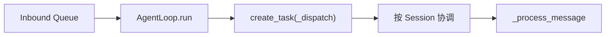

# NanoBot 第 03 章：AgentLoop

> 课程位置：[M01 最小闭环](../README.md) → Ch03 · 顺序 04

## 本章只解决一个问题

AgentLoop 如何持续接收消息，同时保护 Session 顺序并把每条消息送入完整 Turn？

## 小节顺序

| 顺序 | 小节 | 状态 | 核心产物 |
|---:|---|---|---|
| L01 | [create_task 与协作式并发](01-create_task与协作式并发.md) | 已完成 | AgentLoop 响应性时间线 |
| L02 | [Session 锁与跨 Session 并发](02-Session锁与跨Session并发.md) | 已完成 | per-session serial 图 |
| L03 | 入站分支与聚焦测试 | 下一节 | AgentLoop dispatch 地图 |

## 黑盒边界

本章看 `run()` 到 `_dispatch()`、Session 协调和入站分支。七阶段内部、Runner 内部算法、
Context 细节与 Turn Delivery 恢复语义不在本章展开。
