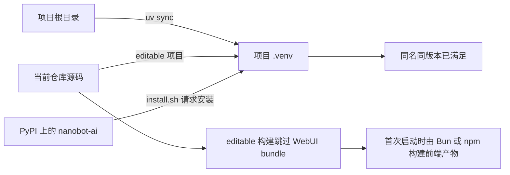

# NanoBot 学习日志 2026-08-25 · Ch00 Editable 安装边界内化

## 本次核心问题

`uv sync` 与 `install.sh` 分别从哪里取得 NanoBot，又把它安装到哪里？

## 结论先行



学习者最终形成的正确表述是：

> `install.sh` 声明从 PyPI 获取 NanoBot，并把它安装到 `uv sync` 构建的 Python
> 虚拟环境中。

这句话解决的是安装脚本的“来源—目标”边界。与它并行的另一条事实是：`uv sync` 已经把
当前仓库源码以 editable 方式安装到了该虚拟环境。

## 1. 运行证据

执行：

```bash
uv pip show nanobot-ai
```

观察到：

```text
Location: <project>/.venv/lib/python3.12/site-packages
Editable project location: <project>/nanobot
```

继续查看：

```bash
cat .venv/lib/python3.12/site-packages/nanobot_ai-*.dist-info/direct_url.json
```

观察到 `url` 指向当前仓库，并且 `dir_info.editable` 为 `true`。这证明当前环境中的
NanoBot 与仓库源码建立了 editable 关联，而不是仅凭目录位置进行猜测。

## 2. 两个动作不能合并理解

| 动作 | 包的来源 | 安装目标 |
|---|---|---|
| `uv sync` | 当前项目仓库源码 | 项目的 `.venv` |
| `install.sh` | 声明为 PyPI | 脚本检测到的活动 Python 环境；本次是项目 `.venv` |

本次两个动作恰好落在同一个虚拟环境，而且项目源码已经以相同包名、相同版本存在，所以
安装脚本的 pip 请求得到 `Requirement already satisfied`。

## 3. Editable 与 WebUI 的边界

`pip install -e .` 中，`.` 表示当前 Python 项目，`-e` 表示 editable。它让环境引用当前
源码目录，修改 Python 源码后通常不需要重新安装。

NanoBot 的 editable 构建跳过的是 **WebUI 前端 bundle 的生产构建**，不是跳过 NanoBot
Python 源码安装。源码启动 WebUI 时，如果 bundle 缺失或过期，会再选择 Bun 或 npm 完成
前端依赖安装与生产构建。

## 4. 为什么这样设计

### 为什么区分安装来源与安装目标

来源回答“取得哪个包”，目标回答“由哪个解释器使用这个包”。把两者分开后，才能解释
为什么同一个安装脚本可能把 PyPI 包放进不同虚拟环境，也能避免把当前目录误认为安装来源。

### 为什么使用 editable 安装

源码学习和开发需要频繁修改代码。editable 关联减少重复安装，让源码改动更快进入下一次
运行验证。

### 为什么 editable 模式跳过 WebUI bundle

Python 依赖同步不必每次都承担 TypeScript/Vite 构建成本。前端产物可以在真正启动 WebUI
或发布 Wheel 时生成。

## 5. 本节涉及的核心元能力

### 证据驱动的环境定位

不能只靠 `which` 或当前目录推断包的来源。应组合查看解释器、console script、包元数据和
`direct_url.json`。

### 正交概念拆分

“来源/目标”“源码/构建产物”“安装时/运行时”是三组不同维度。遇到长命令和长日志时，
先拆维度再形成一句话结论。

### Python 可编辑安装

editable 安装的重点不是“安装在本地”，而是虚拟环境与工作区源码保持关联。

## 6. 内化状态与下次入口

- [x] 用运行证据确认当前 NanoBot 是 editable 项目。
- [x] 区分 `uv sync` 与 `install.sh` 的职责。
- [x] 区分安装来源与安装目标。
- [x] 区分 Python 源码安装与 WebUI bundle 构建。

本次学习闭环已完成。第 00 章尚未结束；下次继续确认 Git commit 与包版本的区别、
CLI/Gateway/API/WebUI 的用途，以及 `nanobot` 命令的 Python entry point。
