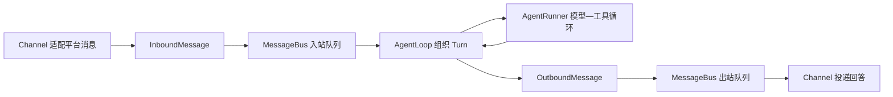

# NanoBot Ch01～Ch02 D+1 合并复习记录

## 本次只提取的 A 层模型

## 学习者原始回忆

> Slack 消息经过通用的输入消息解析器发送到输入消息管道，然后发给 AgentLoop，然后
> AgentLoop 驱动 AgentRunner 调用大模型执行，中间可能进行多轮思考和工具调用，最终回答；
> 所有输出的消息都通过 AgentLoop 发送到输出消息管道，再由输出消息管道发给不同使用端。

## 概念与术语检查

职责主干正确。术语收紧：平台对象由 Slack Channel 适配器转换，不是一个平台无关的通用
解析器；当前“管道”具体是进程内 `asyncio.Queue`。MessageBus 不负责模型与工具循环，因为
它只提供事件传输，不拥有 Agent、Session 或 Tool 的业务规则。

## 自适应排期

| 知识点 | 回忆等级 | 暴露出的缺口 | 下一次复习 |
|---|---:|---|---|
| Ch01 完整 Turn 主干 | 2：清晰 | 无概念缺口 | 2026-09-04（D+7） |
| Ch02 MessageBus 与事件契约 | 2：清晰 | 适配器与 queue 的精确术语 | 2026-09-04（D+7） |

