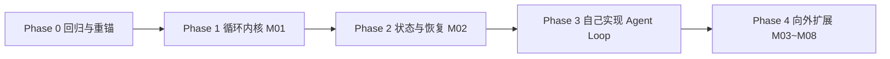

# NanoBot 学习路线（v2 · 循环优先 · 清单驱动）

> 本版本于 2026-11-10 重排。原 44 周固定排期改为**清单驱动**：不再绑定具体周次，
> 每项完成后由学习者记录完成时间并勾选。重心调整为**先从循环入手，再一步一步向外扩展**。

## 路线原则

- **循环优先**：先把 AgentLoop + AgentRunner 这条"模型→工具→模型"的内核吃透，
  再沿真实调用链向外扩到状态、工具、Provider、Channel、显示层。
- **清单驱动**：每项是一个可独立完成、可验收的学习块。完成即勾选并记录时间，
  不追赶"落后周数"，状态不好时只做 20 分钟最低量。
- **每层回到完整 Turn 重新定位**：学完一层，回到一次完整 Turn 里确认它的位置。
- **核心逐行、同构代表深读**：核心代码逐行，同构适配器用代表深读 + 全量矩阵。
- **每章产生可验证作品**，而不是只产生阅读时长。

## 当前基线

| 项目 | 值 |
|---|---|
| 学习基线 commit | `62c05e7f7e6573900af439047fe1579a03deea26` |
| 项目版本 | `v0.4.1-32` |
| 锚定日期 | 2026-11-10 |
| 上一基线 | `9807e9cf`（0.3.0，2026-08-23） |

> 本地 nanobot clone 已于 2026-11-10 同步到 `62c05e7f7`。
> 新旧基线差异与受影响章节见 [源码地图](source-map.md)。

## 阶段总览

| 阶段 | 内容 | 里程碑 |
|---|---|---|
| Phase 0 | 提交笔记、重锚基线、回归复习、修正漂移 | 基线对齐、Ch01/Ch02 图能脱稿重画 |
| Phase 1 | Ch03 收尾 → Ch04 Runner → Ch05 Mini → 复习一 | 独立重写最小 Tool Calling Agent |
| Phase 2 | Ch08 Session → Ch09 Compaction → Ch11 Hook/Checkpoint → 复习二 | 回答"模型这次究竟看见了什么" |
| Phase 3 | 从零实现 4 步 Agent Loop | 一个可运行的自研 Agent Loop |
| Phase 4 | M03~M08 按需外扩 | 达到可修改、可维护的掌握程度 |

---

## Phase 0 · 回归与重锚

> 目标：把 8 月中断前的进度接上，消除版本漂移，确认核心概念没丢。

- [x] 提交 8-28 未提交的笔记（Ch01/Ch02/Ch03 材料、实验、D+1 复习、进度板）
  - 完成时间：2026-11-10
- [x] 本地 nanobot clone `git pull` 到 `62c05e7f7`，确认 `import nanobot` 可用
  - 完成时间：2026-11-10（已 pull 至 `62c05e7f7`，`.venv` 中 `import nanobot` 验证通过）
- [ ] 回归复习：脱稿重画 Ch01 完整 Turn 图 + Ch02 MessageBus 图，重评复习队列
  - 完成时间：
- [x] 新旧基线 diff 核心文件（loop.py / runner.py / bus/），更新 [源码地图](source-map.md)
  - 完成时间：2026-11-10（漂移清单已入 source-map，关键方法名已对照新基线核实）
- [x] 修正 Ch03 笔记方法名漂移（`_dispatch` → `_dispatch_one`），更新 `source_commit`
  - 完成时间：2026-11-10（Ch03 README 已加基线重锚说明，`source_commit` 已更新）

## Phase 1 · 循环内核（M01 最小闭环收尾）

> 目标：吃透"模型→工具→模型"内核，能独立重写一个最小 Agent。

- [ ] **Ch03 L03**：入站分支与聚焦测试（优先命令 / 活动 Session follow-up / 新 Turn 三分支）
  - 产物：AgentLoop dispatch 地图
  - 完成时间：
- [ ] **Ch03 章节验收**：五项解锁标准至少四项为真
  - 完成时间：
- [ ] **Ch04 AgentRunner**：模型请求、Tool Call、Observation、继续迭代、最终答案；
      重试、空响应、长度恢复、并发工具、注入、最大轮次
  - 产物：从零写出简化 Runner 状态机
  - 完成时间：
- [ ] **Ch05 Mini Nanobot**：150~300 行组合 Bus、Runner、Provider Stub、Tool Registry
  - 产物：带两个 Tool、会话历史和终止条件的 Mini Agent
  - 完成时间：
- [ ] **复习一**：脱稿重画 Turn、Bus、Loop、Runner；给 Mini Agent 制造一个终止条件错误并定位
  - 完成时间：

## Phase 2 · 状态与恢复（M02 核心）

> 目标：回答"模型这一次究竟看见了什么"，掌握会话持久化与崩溃恢复。
> Ch06/Ch07/Ch10 作为按需补充，不阻塞主线。

- [ ] **Ch08 Session Key 与 JSONL 持久化**：命名、缓存、元数据、fork、恢复
  - 产物：解析并解释一份真实 Session 文件
  - 完成时间：
- [ ] **Ch09 Context Governance 与 Compaction**：Token 估算、重放预算、裁剪、摘要、空闲压缩
  - 产物：构造超长会话并预测保留内容
  - 完成时间：
- [ ] **Ch11 Hook、Streaming、Checkpoint 与 Turn Delivery**：内容流、进度、文件编辑事件、中断恢复
  - 产物：记录一次 Turn 的事件时间线
  - 完成时间：
- [ ] **复习二**：从空白解释"模型这一次看到了什么"；做一个只读 Session/Context 检视器
  - 完成时间：
- [ ] （按需）Ch06 ContextBuilder / Ch07 Templates·Skills / Ch10 Memory·Dream
  - 完成时间：

## Phase 3 · 自己实现 Agent Loop（毕业作品）

> 目标：不依赖 nanobot 源码，从零实现一个可运行的 Agent Loop。
> 这是整个项目的核心里程碑，对应"先从循环入手"的最终验证。

- [ ] **Step 1 最小内层循环**：模型 → 工具 → 模型闭环（OpenAI 兼容接口，约 150 行）
  - 完成时间：
- [ ] **Step 2 错误处理 + 流式**：空响应重试、finish_reason=length 续写、malformed tool call 降级、流式输出
  - 完成时间：
- [ ] **Step 3 Session + 持久化 / Checkpoint**：会话历史落盘、三相位 checkpoint、崩溃恢复
  - 完成时间：
- [ ] **Step 4 Mid-turn 注入 + Hook**：per-session 队列注入、调模型前/最终回复前 drain、hook 系统
  - 完成时间：
- [ ] **验收**：自研 Loop 与 nanobot 行为对照，写出差异与设计取舍
  - 完成时间：

## Phase 4 · 向外扩展（M03~M08 · 按需 backlog）

> 目标：沿调用链向外扩到工具、长程、Provider、Channel、显示层。
> 此阶段不绑定顺序与时间，按兴趣和需要从清单拉取。每项仍遵守学习协议。

### M03 工具与边界

- [ ] Ch12 Tool Contract、Schema、Registry 与 Loader
- [ ] Ch13 Filesystem、Apply Patch、Search 与 File State
- [ ] Ch14 Shell、Exec Session、取消与 Sandbox
- [ ] Ch15 Web Search、Fetch 与 SSRF
- [ ] Ch16 MCP、Agent Plugin、Skills 与 CLI Apps
- [ ] Ch17 Subagent、Session Messaging 与 Runtime Control

### M04 长程能力

- [ ] Ch18 Sustained Goal 与 Long Task
- [ ] Ch19 Cron、Trigger、Heartbeat 与 Automation Turn
- [ ] Ch20 图片、附件与音频转录
- [ ] 复习三：用状态机解释 Goal/Subagent/Cron/Trigger 的恢复与投递语义

### M05 模型运行时

- [ ] Ch21 Config Schema、Loader 与 Watcher
- [ ] Ch22 Model Preset、Runtime、Registry 与 Factory
- [ ] Ch23 Provider Base、OpenAI Compatible 与 Responses API
- [ ] Ch24 Specialized Provider、OAuth、Fallback 与 Conversation State

### M06 输入输出与常驻运行

- [ ] Ch25 BaseChannel 与事件契约
- [ ] Ch26 Channel Registry、Manager 与 Outbound Delivery
- [ ] Ch27 WebSocket Channel
- [ ] Ch28 Bot SDK Channel 家族
- [ ] Ch29 企业、设备、联邦与邮件 Channel 家族
- [ ] Ch30 Gateway、Process Runtime、Lease 与 Pairing
- [ ] 复习四：随机选一个 Channel 端到端追踪消息

### M07 公开入口与显示层

- [ ] Ch31 Python SDK 与 OpenAI-compatible API
- [ ] Ch32 Command Router 与 CLI
- [ ] Ch33 WebUI Bootstrap 与 NanobotClient
- [ ] Ch34 Stream Projection、Session 与活动状态
- [ ] Ch35 Components、Workbench 与 Settings
- [ ] Ch36 构建、打包、部署、测试与安全总审计

### M08 掌握验证

- [ ] Ch37 架构内扩展（带测试、文档、安全说明）
- [ ] Ch38 跨层故障诊断（只靠日志、测试、源码定位）
- [ ] Ch39 架构答辩（脱稿讲解 + 重新设计取舍）

## 最终完成标准

- 能从任意入口追踪一次 Turn。
- 能解释 Context、Session、Memory 三者的区别。
- 能安全地扩展 Tool、Provider 或 Channel。
- 能定位长任务、流式输出、恢复和重复投递问题。
- 能为修改选择正确的模块所有者和验证层级。
- 能说明 NanoBot 当前设计的优势、限制与演进方向。
- **能从零实现一个可运行的 Agent Loop（Phase 3 里程碑）。**

## 附：原 44 周排期（历史参考）

v1 的固定周次排期已废弃，仅保留章节与模块的对应关系供参考：
M01 第 1~7 周、M02 第 8~14 周、M03 第 15~20 周、M04 第 21~24 周、
M05 第 25~28 周、M06 第 29~35 周、M07 第 36~41 周、M08 第 42~44 周。
章节内容与验收标准不变，执行方式改为上方清单驱动。
